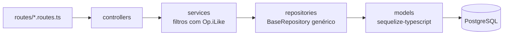
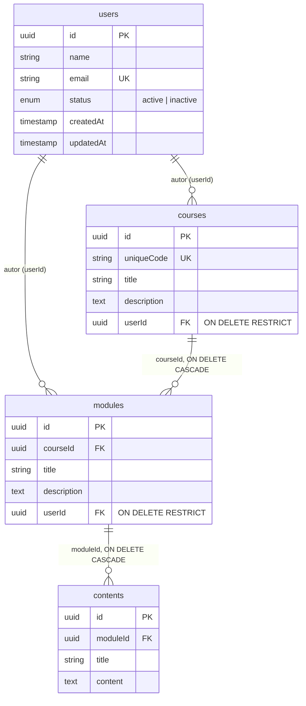

# EDULMS

API REST de um LMS (Learning Management System) simples: usuários criam cursos, cursos têm módulos e módulos têm conteúdos. Exercício do processo seletivo da MM, feito em TypeScript com Express 5, Sequelize e PostgreSQL, organizado em camadas (rotas → controllers → services → repositories → models).

## Funcionalidades

- CRUD de **usuários** (`/users`), **cursos** (`/courses`), **módulos** (`/modules`) e **conteúdos** (`/contents`).
- Filtros na listagem: cursos por `title` (busca parcial), `uniqueCode` e `userId`; módulos por `courseId`, `title` e `userId`; conteúdos por `moduleId` e `title`.
- IDs em UUID, migrations com `sequelize-cli` e exclusão em cascata de curso → módulos → conteúdos.

Antes de usar, leia as [limitações conhecidas](#limitações-conhecidas): as rotas de cursos não funcionam no código atual.

## Como funciona



`src/config/database.ts` cria a instância do Sequelize e carrega todos os arquivos de `src/models`. O `index.ts` só sobe o servidor depois que `sequelize.authenticate()` conecta no banco; o schema vem das migrations, não de `sync()`.

### Modelo de dados



Todas as tabelas têm `createdAt` e `updatedAt`.

## Stack

Node.js, TypeScript 5.8, Express 5, Sequelize 6 + sequelize-typescript, sequelize-cli, PostgreSQL, ts-node-dev.

## Como rodar

### Pré-requisitos

- Node.js 20 ou superior
- PostgreSQL (local ou em Docker)

Banco rápido com Docker:

```bash
docker run -d --name edulms-db -e POSTGRES_USER=edulms -e POSTGRES_PASSWORD=edulms -e POSTGRES_DB=edulms -p 5432:5432 postgres:16
```

### Configuração

```bash
npm install
cp .env.example .env
```

| Variável | Exemplo | Uso |
|---|---|---|
| `DB_HOST` | `localhost` | Host do PostgreSQL |
| `DB_PORT` | `5432` | Porta (padrão 5432) |
| `DB_USER` | `edulms` | Usuário |
| `DB_PASS` | `edulms` | Senha |
| `DB_NAME` | `edulms` | Banco |
| `PORT` | `3000` | Porta da API (padrão 3000) |

### Migrations

Não há `.sequelizerc`, então o caminho do config e das migrations vai na linha de comando:

```bash
npx sequelize-cli db:migrate --config src/config/config.js --migrations-path src/migrations
```

A primeira migration cria a extensão `uuid-ossp`; o usuário do banco precisa de permissão para isso.

### Subir a API

```bash
npm run dev
# Conectado ao banco de dados com sucesso.
# Servidor rodando em http://localhost:3000
```

## API

| Método | Rota | Corpo obrigatório | Resposta |
|---|---|---|---|
| GET | `/` | | texto de boas-vindas |
| GET | `/users` | | 200 lista |
| POST | `/users` | `name`, `email` (`status` opcional) | 201 |
| GET / PUT / DELETE | `/users/:id` | | 200 / 200 / 204, 404 se não existe |
| GET | `/courses?title=&uniqueCode=&userId=` | | 200 lista |
| POST | `/courses` | `title`, `uniqueCode`, `userId` | 201 |
| GET / PUT / DELETE | `/courses/:id` | | ver limitações |
| GET | `/modules?courseId=&title=&userId=` | | 200 lista |
| POST | `/modules` | `title`, `courseId`, `userId` | 201 |
| GET / PUT / DELETE | `/modules/:id` | | 200 / 200 / 204, 404 se não existe |
| GET | `/contents?moduleId=&title=` | | 200 lista |
| POST | `/contents` | `title`, `content`, `moduleId` | 201 |
| GET / PUT / DELETE | `/contents/:id` | | 200 / 200 / 204, 404 se não existe |

Erros de validação e do banco voltam como `400 { "error": "<mensagem do Sequelize/PostgreSQL>" }`; registro inexistente volta `404 { "message": "... not found" }`.

Exemplo, testado contra PostgreSQL 16:

```bash
curl -X POST http://localhost:3000/users -H "Content-Type: application/json" \
  -d '{"name":"Ana Ribeiro","email":"ana.ribeiro@exemplo.com"}'
# 201 {"id":"92b0bbae-...","status":"active","name":"Ana Ribeiro","email":"ana.ribeiro@exemplo.com",...}

curl "http://localhost:3000/contents?moduleId=001623bd-0f0b-4e0c-8550-0e4596e2ac41"
# 200 [{"id":"40fde289-...","moduleId":"001623bd-...","title":"string, number e boolean","content":"Texto da aula",...}]
```

### Documentação da API

- OpenAPI 3.0: [`docs/openapi.yaml`](docs/openapi.yaml). Para ver: cole em https://editor.swagger.io ou rode `npx @redocly/cli@1.34.3 preview-docs docs/openapi.yaml`.
- Postman: importe [`docs/postman/EDULMS.postman_collection.json`](docs/postman/EDULMS.postman_collection.json). `baseUrl` aponta para `http://localhost:3000`, e cada "Criar" guarda o id em `userId`, `courseId`, `moduleId` ou `contentId` para as próximas requisições.

## Estrutura

```
src/
├── index.ts          # Express, rotas e conexão com o banco
├── config/
│   ├── config.js     # config do sequelize-cli (lê o .env da raiz)
│   └── database.ts   # instância do Sequelize usada pela API
├── routes/           # um arquivo por recurso
├── controllers/      # validação simples e respostas HTTP
├── services/         # regras e filtros de listagem
├── repositories/     # BaseRepository (create, findById, findAll, update, delete)
├── dtos/             # interfaces de entrada por recurso
├── models/           # Course, Module, Content, User
└── migrations/       # 7 migrations do sequelize-cli
```

## Testes

Não há testes automatizados (`npm test` só imprime a mensagem padrão do npm). `npx tsc --noEmit` acusa os dois erros descritos abaixo.

## Limitações conhecidas

- **Rotas de cursos quebradas.** O arquivo é `src/models/course.ts`, mas a classe é `Course`. O `sequelize-typescript` só registra o model quando o nome do arquivo bate com o nome exportado, então `Course` nunca é inicializado e toda operação em `/courses` volta `400 Model not initialized`. Em Linux (sistema de arquivos sensível a maiúsculas) os imports `../models/Course` nem resolvem. Renomear o arquivo para `Course.ts` resolve.
- `CourseController` não tem o método `getById`: `GET /courses/:id` responde 500 com uma página HTML de erro (`controller.getById is not a function`).
- Como não dá para criar curso pela API, módulos e conteúdos só podem ser testados com um curso inserido direto no banco.
- `GET /users` ignora os filtros: o service aceita `name`, `email` e `status`, mas o controller chama `getAll()`.
- Os models `Course` e `Module` declaram `userId` como `INTEGER`, enquanto a migration e `users.id` usam UUID. Funciona porque o banco vem das migrations, mas um `sequelize.sync()` criaria a coluna errada.
- A migration `add-timestamps-to-users` cria `created_at` e `updated_at` além dos `createdAt`/`updatedAt` que já existiam; o model usa os nomes em camelCase e as colunas novas ficam sem uso.
- `src/config/config.js` imprime usuário, **senha** e nome do banco no console sempre que o `sequelize-cli` roda.
- Os ids de caminho não são validados: um valor que não é UUID volta 400 com a mensagem crua do PostgreSQL.
- `src/models/indexx.txt` é um arquivo solto sem uso.
- Os dados de seed citados no histórico de commits não estão no repositório.

## Licença

ISC (campo `license` do `package.json`).
